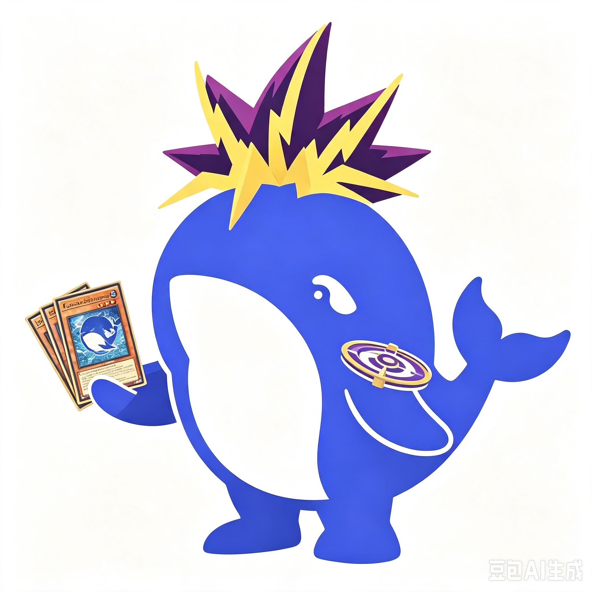

<div align="center">



# ygopromcp

**A ygopro GUI instance with an MCP (Model Context Protocol) control plane.**

A fork of [fluorohydride/ygopro](https://github.com/Fluorohydride/ygopro) that
exposes the running Yu-Gi-Oh! client as a JSON-RPC/MCP stdio server — an AI
agent (Claude Code, Codex, or any MCP client) reads the board state and plays
the game through the same event receivers a human click uses.

</div>

---

## What it does

The bridge is **always on** (no `--mcp` flag, no CLI join flags). Launch the
client, then drive it tool-by-tool:

| Tool | Purpose | Blocks? |
|---|---|---|
| `ygo_connect` | Join a room (nickname, host, port, password, deck path), auto-ready, poll start if host; returns at the first decision point | YES |
| `ygo_choose` | Answer the pending prompt (`id` = int **or** list of ints) and block until the next decision point | YES |
| `ygo_card` | Explain a card on one line (ydkshow-style) by name or code | no |
| `ygo_chat` | Send a chat message to the room | no |
| `ygo_surrender` | Surrender the duel (blocks until the server responds) | YES |
| `ygo_disconnect` | Leave the room (immediate) | no |

Every blocking response is one **text block**:

```
# log
<recent narration, terse>

# state
<board as a 5×5 markdown table + fzone column>

# card explain
<one-line explains for cards mentioned but not explained for N turns>

# options: min~max/total
0. <option>
1. <option>
...
```

The `# options` section is present only when the agent must decide. Option ids
are 0-based; pick a subset of size `k` in `[min,max]` (a list `id`), or one
option (an int `id`). A cancelable prompt renders as `min=0` and an **empty**
`id=[]` cancels it. A prompt with exactly one way to answer (`min~max/1`) is
auto-answered by the bridge and never reaches the agent.

The agent never needs game logic: read the header, pick a random (or computed)
subset, send `id`. Invalid choices are not offered: level-sum (synchro) selects
enumerate only valid combinations, and single-card selects
(`MSG_SELECT_UNSELECT_CARD`) always respond with exactly one card.

The bridge is deliberately dumb about the *client*: choices come from the
game's own parsed state, responses go through the game's own builders
(`SetResponseSelectedCards`, `RespondZones`, `RespondSortOrder`), and a
monotonic STOC sequence counter gates every action so stale prompts are never
re-answered (the source of the classic "invalid operation" rejections).

## Building

Prerequisites (Linux; the fork builds with the same toolchain as upstream):

- C++17 compiler (gcc/clang)
- [premake5](https://github.com/premake/premake-core)
- libevent, sqlite3, Lua 5.3 (headers + lib)
- [mercury233/irrlicht](https://github.com/mercury233/irrlicht) at `./irrlicht`
- nlohmann/json (vendored via premake in this fork)
- submodules: `git submodule update --init --recursive`

```bash
git clone --recursive https://github.com/<you>/ygopromcp
cd ygopromcp
premake5 gmake --lua-include-dir=/usr/include/lua5.3 --lua-lib-name=lua5.3
make -C build config=release -j$(nproc)
# binary: bin/release/YGOPro
```

## Running

Launch the client (no flags needed — the MCP stdio server takes over stdout,
app output goes to stderr), then call `ygo_connect`:

```json
{ "method": "tools/call", "params": { "name": "ygo_connect",
  "arguments": { "host": "127.0.0.1", "port": "7911", "password": "RoomName",
                 "name": "MyName", "deck": "/path/to/deck.ydk" } } }
```

Requires a YGOPro server (e.g. srvpro) on the target host. In a password room
the duel starts when the host clicks start; `system.conf` in this fork sets
`chkMAutoPos/chkSTAutoPos/chkRandomPos/chkAutoChain = 1` (auto-place + forced
auto-chain) — keep those for agent play.

## Hooking up an agent

MCP stdio client config (`.mcp.json`):

```json
{
  "mcpServers": {
    "ygopromcp": {
      "type": "stdio",
      "command": "/abs/path/to/YGOPro",
      "args": []
    }
  }
}
```

Agent loop (the entire strategy):

1. `ygo_connect` → blocks until the first decision (RPS / turn order / prompt).
2. Parse the `# options: min~max/total` header in the text block.
3. `ygo_choose {"id": <int or list of ints>}` → blocks until the next decision.
4. Repeat until `Game Over` appears in the block.

Wire protocol: newline-delimited JSON-RPC 2.0 on stdin/stdout, with
`initialize` → `tools/list` → `tools/call` (standard MCP stdio handshake).
`YGOCLI_MCP_DEBUG=1` prints `[mcp]`/`[stoc]`/`[ctos]` traces to stderr.

The graphical deck editor also has local MCP controls. `ygo_deck_list` lists
available local decks, and `ygo_deck_open {"deck":"name","category":"local"}`
loads one into the visible editor. `ygo_deck_search {"query":"text"}` uses the
editor search. `ygo_deck_add` and `ygo_deck_remove` accept a numeric `code`, a
`main`, `extra`, or `side` section, and an optional count from 1 to 3.
`ygo_deck_save` saves only the currently selected existing local deck. Deck
switching refuses unsaved edits, and editor card, section, alias, and limit
rules also apply to MCP edits. These tools do not join a room.

## Testing

```bash
# start a server first, then (from tests/):
python3 tests/fork_aggro_play.py <room-name> <deck.ydk>
```

A pure-random agent plays full games against itself through the bridge
(entry via `ygo_connect`); the test passes when turns advance and the game
reaches a natural `Game Over` or the run-time cap without deadlock. A per-run
transcript is written to `/tmp/mcp_transcript.log` (every send/receive with
timestamps).

## Caveats

- The duel bridge drives network play (connect → lobby → RPS → turn order →
  duel). The separate deck tools use the graphical editor; single-player and
  replay controls remain out of scope. Replay playback narrates the log but is
  untested.
- Tag duels and match (BO3) siding are unverified.
- A deck rejected by the server shows a modal popup the agent cannot click;
  the reason is surfaced in the `# log` section as `[!] deck rejected: ...` —
  switch decks rather than waiting.
- Constrained combo selects (tribute etc.) can still be rejected by the core;
  the retry flow re-prompts, and the test watchdog surrenders unsolvable ones.
- Opponent hand contents and draw names are never exposed (count-only), even
  though the ygopro v1 protocol leaks draw codes to the client.
- See [TODO.md](TODO.md) for the full list of known and suspected issues.

## Credits

- [fluorohydride/ygopro](https://github.com/Fluorohydride/ygopro) — the game
  client this is forked from.
- [mycard/srvpro](https://github.com/mycard/srvpro) — the reference server used
  in testing.
